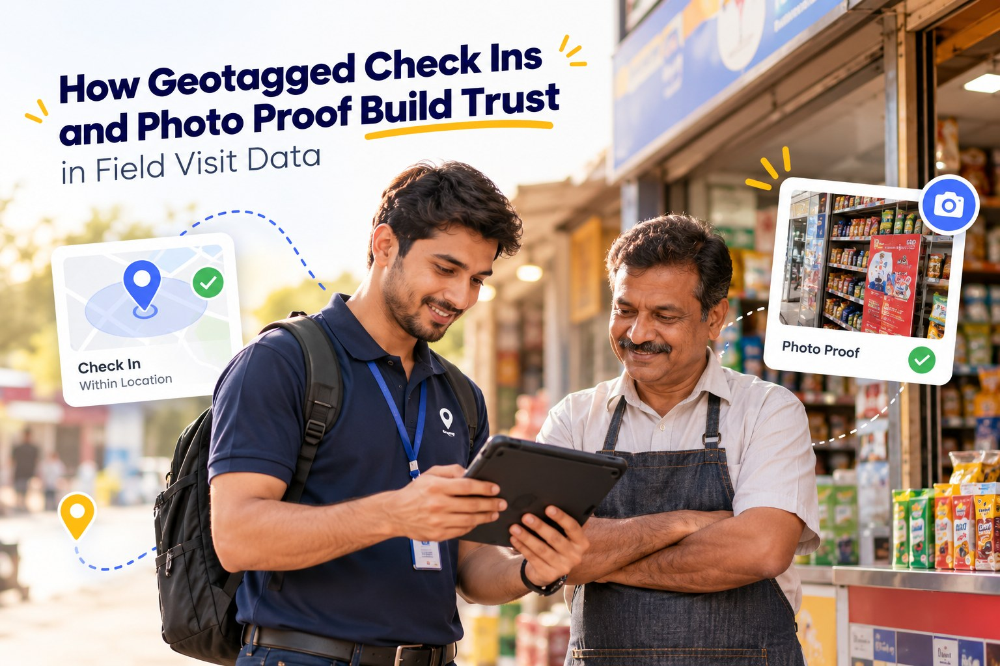

# How Geotagged Check Ins and Photo Proof Build Trust in Field Visit Data

Every sales manager has had this moment. You open the daily visit report and everything looks fine. Nine visits logged, notes filled in, a couple of orders booked. Then a distributor calls and mentions, almost in passing, that nobody from your company has dropped by in two weeks.

Now you have a bigger problem than one missed visit. You don't know which part of the report to believe, or whether the other reports are any better.

It isn't always about dishonesty. Sometimes a rep fills in the report late at night from memory and mixes up the details. Sometimes the shop was shut and the visit still got marked as done. Either way, the data that should guide your decisions can't be relied on.

Geotagged check ins and photo proof close that gap. Let's look at why field visit data goes wrong so often, how these two features work, and how they make life easier for managers and honest reps alike.

## Why Field Visit Data Is So Hard to Trust

Traditional field reporting depends almost entirely on what the rep says happened. A visit gets written in a register, typed into an Excel sheet or sent as a WhatsApp message to the manager. There is no easy way to check any of it, and that leads to a few familiar problems.

- **Reports written from memory.** A rep who meets twelve customers and fills in the report at 8 pm will forget things. Times get rounded and small visits get left out or added by mistake.
- **No way to separate good work from padding.** The rep who covered every outlet and the rep who covered half of them can submit reports that look exactly alike.
- **Managers turn into detectives.** Checking a report means calling the customer or visiting the area in person, which wastes time and feels awkward for everyone.
- **Decisions built on shaky numbers.** Targets, incentives and territory changes all depend on visit data. If the data is off, every decision built on it is off too.

The worst part is what this does to team culture. When managers can't verify anything, they start doubting everyone, and your best reps end up under the same suspicion as the ones cutting corners.

## What Is a Geotagged Check In?

A geotagged check in is a simple idea. When a rep reaches a customer, they tap a button in their mobile app. The app records the GPS location of the phone, the exact time and the customer being visited.

The system then compares that location with the customer's saved address. If the rep is within an agreed distance, say 100 or 200 metres, the check in is valid. If not, it gets flagged. When the rep leaves, they check out, so you also know how long the visit lasted. A five minute stop and a forty minute meeting look very different in the data, and that difference matters.

Many teams also set a geofence, which is a virtual boundary around each customer location. Some allow check ins only inside it, while others simply highlight visits that happened outside. Either way, location becomes part of the record instead of something the manager has to take on faith.

## Why Photo Proof Adds the Missing Piece

Location tells you the rep was there. It doesn't tell you what they did.

That's where photos come in. A photo taken inside the app during a visit is stamped with the time and location automatically. Because it is captured live and not picked from the phone gallery, an old picture from last month can't be passed off as today's work. Depending on your business, reps might photograph things like these.

- Shelf displays and stock levels in retail outlets
- Posters, standees and other promotional material put up in a store
- Signed delivery challans or order copies
- A machine or product after installation or repair
- Competitor displays or offers spotted in the market

A good photo also shows what is really happening on the ground. A manager in the head office can see that a shelf in a Nashik store is half empty, or that a display the retailer agreed to was never set up. A line in a report saying "visit done" will never tell you that.

## How Geotagged Check Ins and Photo Proof Build Trust

### 1. Managers can verify work without chasing anyone

With location, time and photos attached to every visit, field visit verification takes minutes. A manager can review a rep's whole day without calling customers or driving out to the area. If something looks unusual, like a check in far from the customer address, it stands out right away and can be discussed calmly instead of turning into an accusation.

### 2. Honest reps finally get the credit they deserve

This is the benefit most companies don't expect. When visits are verified, reps doing real work no longer have to defend themselves. If a customer claims nobody came, the rep can point to a check in with a photo of the shop counter from that afternoon. Good performers stand out clearly, and incentives can be linked to visits that actually happened.

### 3. Cleaner data leads to better decisions

Once you trust your visit data, you can actually use it. You can see which outlets are visited too rarely, which areas take too long to cover and which reps spend the most time with high value customers. A good [field sales automation](https://trackolap.com/product/sales-crm/field-sales-automation-software) platform turns these check ins into coverage reports, so your planning is based on what really happened in the field.

### 4. Fewer disputes over travel claims and attendance

Travel allowance is one of the most common sources of friction in field teams. When every visit has a location attached, matching a claim with the places a rep actually went becomes easy. Combined with [expense management](https://trackolap.com/product/sales-crm/expense-management-software) and [attendance tracking](https://trackolap.com/product/hr-management/attendance-and-leave-management-software), this removes most of the back and forth between reps, managers and the accounts team.

### 5. Customers notice the difference

Fewer customers get skipped when visits are tracked properly. And when a retailer says the promotional material never arrived, a dated photo settles it in seconds. Over time, retailers start to see your company as organised and dependable.

## Where This Works Best

Some industries see results very quickly. FMCG companies use photos to check shelf share and display compliance and to improve retail coverage. Pharma companies use geotagged check ins to confirm doctor and chemist visits. Insurance agents record customer meetings, and lenders use location based visit verification to stop fake visits. Service teams rely on before and after photos to show a job was done properly, and merchandising agencies use photo reports as proof of the work they bill brands for.

## How to Roll It Out Without Upsetting Your Team

Location based check ins can make some reps nervous. How you introduce the system decides whether it is accepted or quietly resisted.

1. **Explain the purpose first.** Tell your team the goal is easier reporting and protection in disputes, not catching them out. Fewer long reports at night is a benefit they will feel immediately.
2. **Fix your customer locations.** If a customer's pin on the map is wrong, genuine visits will get flagged. Clean up addresses and pin locations before going live.
3. **Keep photo rules simple.** One or two clear photos per visit, each with a purpose, is enough. Ten photos per visit will only slow reps down.
4. **Set a realistic geofence radius.** Factories, malls, hospitals and rural addresses often need a wider boundary. Too tight a radius only creates false alerts.
5. **Plan for poor network.** Reps often work in basements, small towns or villages with weak signal. Choose an app that saves check ins offline and syncs them once the connection returns.
6. **Track only during work hours.** Stopping location tracking when the workday ends builds trust, and laws such as India's DPDP Act make transparency about employee data more important than ever.
7. **Coach, don't just punish.** Review visit reports with your team every week. If a rep keeps missing certain outlets, find out why. Often the route itself is the problem, and that is something proper [beat planning software](https://trackolap.com/product/sales-crm/beat-planning-software) can fix.

## Final Thoughts

Field teams run on trust. Managers need to trust what reps report, reps need to trust that their effort will be noticed, and customers need to trust that someone will turn up when promised.

Geotagged check ins and photo proof don't replace that trust. They give it something solid to stand on. Instead of arguing over whose version of events is right, everyone looks at the same record.

If your team still runs on registers, spreadsheets or end of day messages, start small. Pick one region, switch to verified check ins for a month and compare the data with what you had before. To see how it works in practice, book a demo with TrackOlap and explore how [live employee tracking](https://trackolap.com/product/sales-crm/employee-live-tracking-system) and verified field visits can fit your team.

## Frequently Asked Questions

### What is a geotagged check in?

It is a visit record created when a field rep taps check in on a mobile app at a customer location. The app captures the GPS location and time automatically and links them to that customer.

### Can field reps fake their GPS location?

Some people do try fake location apps or proxy check ins. A good field app can detect when mock location settings are switched on and flag those check ins. Live photos taken inside the app add a second layer of proof.

### What happens if there is no internet at the customer location?

Many field apps store the check in and photos on the phone and upload them once the network returns. The original time and location are kept, so the record stays accurate.

### Will taking photos slow down my reps?

Not if the rules are simple. One or two photos take a few seconds, and most reps save time overall because they no longer write long reports at the end of the day.

### Is it legal to track the location of field employees?

In most cases, companies can track location for genuine work purposes during working hours. Employees should be told clearly what is collected and why, and tracking should stop after work hours. Laws such as India's DPDP Act put extra weight on this kind of transparency, so it is worth reviewing your policy with a legal advisor.

### How does geotagging help with expense claims?

Since every visit is linked to a location, managers can compare travel claims with the places a rep actually visited. Approvals get faster and fake expense claims become much harder to pass.
